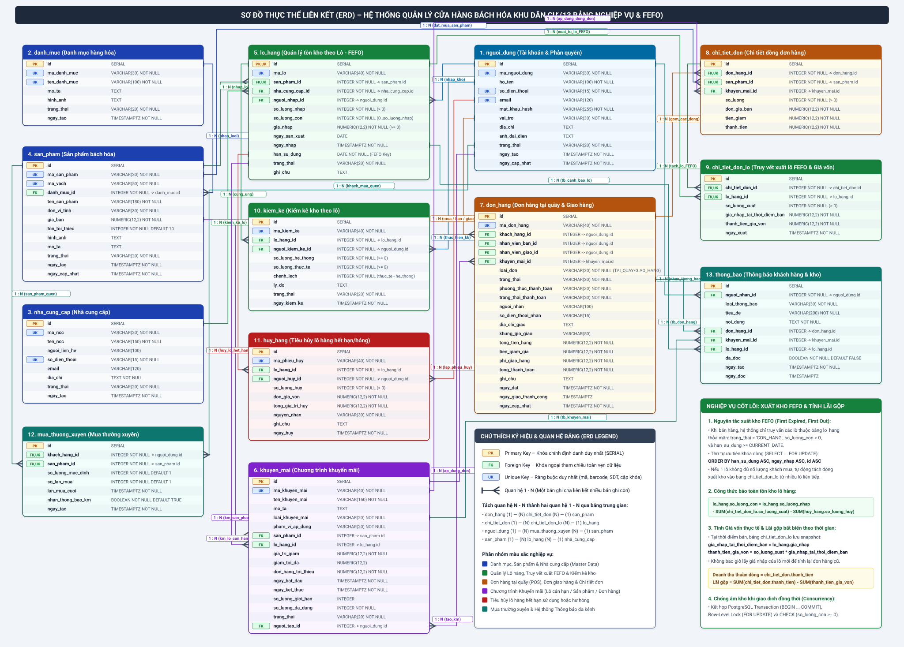

# Cơ Sở Dữ Liệu – Hệ Thống Quản Lý Cửa Hàng Bách Hóa Khu Dân Cư (`404-not-found`)

## 1. Giới thiệu & Công nghệ sử dụng

Module Database của dự án **Hệ thống quản lý cửa hàng bách hóa khu dân cư** (môn **INT4211**) được xây dựng trên **PostgreSQL 15+** (tương thích PostgreSQL Local và **Supabase**), gồm **13 bảng nghiệp vụ** phục vụ quản lý danh mục, sản phẩm, nhập kho theo lô, bán hàng tại quầy (POS), đặt đơn giao hàng, kiểm kê, hủy hàng hết hạn và khuyến mãi.

- **Quy ước thiết kế**: Tên bảng/cột chuẩn `snake_case` tiếng Việt không dấu; tiền tệ dùng `NUMERIC(12, 2)`; thời gian dùng `TIMESTAMPTZ` và `DATE`; mật khẩu mã hóa `bcrypt` (`$2b$10$...`); hình ảnh lưu URL `TEXT` (Supabase Storage).
- **Trọng tâm nghiệp vụ**: Quản lý tồn kho theo từng **Lô hàng (`lo_hang`)**, xuất kho ưu tiên lô có hạn sử dụng gần nhất theo nguyên tắc **FEFO (First Expired, First Out)** và lưu lại giá nhập thực tế tại thời điểm bán trong bảng `chi_tiet_don_lo` để tính chính xác giá vốn – lãi gộp.

---

## 2. Danh sách 13 bảng nghiệp vụ

Các bảng được định nghĩa theo đúng thứ tự phụ thuộc khóa ngoại trong [`database/schema.sql`](./schema.sql):

| STT | Tên bảng | Mô tả chức năng chính | Số bản ghi mẫu (`seed.sql`) |
|---:|---|---|---:|
| 1 | `nguoi_dung` | Quản lý tài khoản và phân quyền 4 vai trò: `CHU_CUA_HANG`, `NHAN_VIEN_BAN_HANG`, `NHAN_VIEN_GIAO_HANG`, `KHACH_HANG`. | **35** |
| 2 | `danh_muc` | Phân nhóm ngành hàng bách hóa thiết yếu (Sữa, Đồ uống, Mì ăn liền, Gạo & đồ khô, Gia vị, Bánh kẹo, Đông lạnh, Hóa mỹ phẩm, Gia dụng, Mẹ & bé). | **10** |
| 3 | `nha_cung_cap` | Thông tin nhà phân phối, người liên hệ, số điện thoại (`UNIQUE`), địa chỉ và trạng thái hợp tác. | **12** |
| 4 | `san_pham` | Thông tin mặt hàng, mã vạch (`ma_vach` EAN-13 quét tại quầy), đơn vị tính, giá bán niêm yết và ngưỡng `ton_toi_thieu`. | **160** |
| 5 | `lo_hang` | Quản lý tồn kho theo từng lô nhập: `so_luong_nhap`, `so_luong_con`, `gia_nhap`, `ngay_nhap`, `han_su_dung` và `trang_thai` (`CON_HANG`, `HET_HANG`, `HET_HAN`, `DA_HUY`). | **340** |
| 6 | `khuyen_mai` | Chương trình giảm giá (`PHAN_TRAM` / `SO_TIEN`) áp dụng cho lô cận hạn (`LO_CAN_HAN`), sản phẩm (`SAN_PHAM`) hoặc toàn đơn (`DON_HANG`). | **20** |
| 7 | `don_hang` | Đơn bán tại quầy (`TAI_QUAY`) và đơn đặt giao hàng (`GIAO_HANG`), quản lý trạng thái đơn, khung giờ giao và công thức thanh toán. | **120** |
| 8 | `chi_tiet_don` | Chi tiết từng mặt hàng khách mua trong đơn hàng (`so_luong`, `don_gia_ban`, `tien_giam`, `thanh_tien`). | **420** |
| 9 | `chi_tiet_don_lo` | Truy vết từng lô hàng đã xuất theo FEFO cho mỗi dòng `chi_tiet_don`, lưu `so_luong_xuat`, `gia_nhap_tai_thoi_diem_ban` và `thanh_tien_gia_von`. | **447** |
| 10 | `kiem_ke` | Biên bản kiểm kê tồn kho thực tế theo từng lô, đối chiếu `so_luong_he_thong` và `so_luong_thuc_te` để tính `chenh_lech`. | **25** |
| 11 | `huy_hang` | Phiếu tiêu hủy các lô hàng hết hạn sử dụng (`HET_HAN`) hoặc hư hỏng (`HU_HONG`), lưu `so_luong_huy`, `don_gia_von` và `tong_gia_tri_huy`. | **20** |
| 12 | `mua_thuong_xuyen` | Danh sách sản phẩm mua quen thuộc của khách hàng và đăng ký nhận thông báo khi có khuyến mãi hàng cận hạn. | **60** |
| 13 | `thong_bao` | Thông báo gửi người dùng theo 4 nhóm: `KHUYEN_MAI`, `DON_HANG`, `CANH_BAO_KHO` (tồn thấp, lô cận hạn < 7 ngày) và `HE_THONG`. | **50** |

*(Tài khoản mẫu trong `nguoi_dung` có mật khẩu mặc định là `MatKhau@123`, đã lưu dưới dạng bcrypt hash).*

---

## 3. Sơ đồ ERD & Quan hệ giữa các bảng

File sơ đồ ERD: [`docs/diagrams/erd.svg`](../docs/diagrams/erd.svg)



**Các liên kết trọng tâm:**
- `danh_muc (1) ── (N) san_pham (1) ── (N) lo_hang (N) ── (1) nha_cung_cap`: Phân loại sản phẩm và quản lý các lô nhập kho.
- `don_hang (1) ── (N) chi_tiet_don (1) ── (N) chi_tiet_don_lo (N) ── (1) lo_hang`: Một đơn hàng gồm nhiều dòng sản phẩm; mỗi dòng sản phẩm có thể được tách xuất tự động từ 1 hoặc nhiều lô hàng theo thứ tự FEFO.
- `lo_hang (1) ── (N) kiem_ke / huy_hang / khuyen_mai`: Kiểm kê, tiêu hủy lô hết hạn và khuyến mãi xả hàng lô cận hạn.
- `nguoi_dung (1) ── (N) don_hang / mua_thuong_xuyen / thong_bao`: Liên kết khách hàng, nhân viên bán, nhân viên giao với đơn hàng và thông báo.

---

## 4. Hướng dẫn Clone và Khởi tạo Database từ GitHub

Mỗi thành viên trong nhóm tự khởi tạo một Database PostgreSQL độc lập trên máy cá nhân, sử dụng **tài khoản `postgres` và mật khẩu PostgreSQL riêng của máy mình** (không phụ thuộc vào máy hay mật khẩu của thành viên khác).

### 4.1. Yêu cầu môi trường
- **PostgreSQL 15+** đã cài đặt kèm **pgAdmin 4** hoặc công cụ dòng lệnh **`psql`** (Tải tại: https://www.postgresql.org/download/).
- Kiểm tra dịch vụ PostgreSQL đang hoạt động:
  - **Windows (PowerShell)**: `Get-Service *postgres*` (trạng thái `Running`) hoặc `pg_isready -h 127.0.0.1 -p 5432`
  - **macOS / Linux (Terminal)**: `pg_isready -h 127.0.0.1 -p 5432`

### 4.2. Lấy mã nguồn từ GitHub
```bash
# Clone repository lần đầu
git clone https://github.com/trgphuocsang/404-not-found.git
cd 404-not-found

# Hoặc cập nhật code mới nhất nếu đã có repository trên máy
git checkout main
git pull origin main
```

### 4.3. Tạo Database mới (`bach_hoa_404`)
Thống nhất sử dụng tên Database local là **`bach_hoa_404`**:
- **Cách 1 (Trên pgAdmin 4)**: Mở **pgAdmin 4** -> ở cột trái click chuột phải vào **`Databases`** -> **Create** -> **Database...** -> nhập tên `bach_hoa_404` -> nhấn **Save**.
- **Cách 2 (Bằng dòng lệnh `psql`)**:
  ```bash
  psql -U postgres -c "CREATE DATABASE bach_hoa_404 WITH ENCODING 'UTF8';"
  ```

### 4.4. Chạy `database/schema.sql` (Tạo 13 bảng & 26 chỉ mục)
File [`database/schema.sql`](./schema.sql) dùng `CREATE TABLE IF NOT EXISTS` nên an toàn, không tự động xóa bảng đã có.
- **Cách 1 (Bằng `psql` tại thư mục gốc `404-not-found`)**:
  ```bash
  psql -U postgres -d bach_hoa_404 -v ON_ERROR_STOP=1 -f database/schema.sql
  ```
- **Cách 2 (Trên pgAdmin 4)**:
  1. Click chuột phải vào database **`bach_hoa_404`** -> chọn **Query Tool**.
  2. Nhấn biểu tượng **Open File** (hình thư mục) -> chọn file `database/schema.sql`.
  3. Nhấn **Execute Script** (biểu tượng `▶` hoặc phím **`F5`**).
  4. Mở rộng `bach_hoa_404` -> `Schemas` -> `public` -> click chuột phải vào **`Tables`** chọn **Refresh** để kiểm tra đã có đủ **13 bảng**.

### 4.5. Chạy `database/seed.sql` (Nạp dữ liệu mẫu)

> **⚠️ Cảnh báo `TRUNCATE`**: File [`database/seed.sql`](./seed.sql) có lệnh `TRUNCATE TABLE ... RESTART IDENTITY CASCADE` ở đầu file sẽ xóa toàn bộ dữ liệu hiện có trong 13 bảng trước khi nạp dữ liệu mẫu. **Chỉ chạy `seed.sql` khi khởi tạo Database mới hoặc làm mới môi trường kiểm thử; không chạy trên Database dùng chung đang có dữ liệu thật.**

- **Cách 1 (Bằng `psql` tại thư mục gốc `404-not-found`)**:
  ```bash
  psql -U postgres -d bach_hoa_404 -v ON_ERROR_STOP=1 -f database/seed.sql
  ```
- **Cách 2 (Trên pgAdmin 4)**: Trong **Query Tool** của `bach_hoa_404` -> nhấn **Open File** -> chọn `database/seed.sql` -> nhấn **Execute Script (`F5`)**.

---

## 5. Kiểm tra kết quả sau khi khởi tạo

Mở **Query Tool** của `bach_hoa_404` trên pgAdmin 4 (hoặc `psql -U postgres -d bach_hoa_404`) và chạy các lệnh kiểm tra sau:

```sql
-- 1. Kiểm tra đủ 13 bảng và 26 index tối ưu truy vấn (57 tổng index nếu tính cả PK/UNIQUE)
SELECT
    (SELECT COUNT(*) FROM information_schema.tables WHERE table_schema = 'public' AND table_type = 'BASE TABLE') AS so_bang,
    (SELECT COUNT(*) FROM pg_indexes WHERE schemaname = 'public' AND indexname LIKE 'idx_%') AS so_index_tu_tao;

-- 2. Kiểm tra số lượng bản ghi trong từng bảng (Tổng cộng 1,719 bản ghi, khớp bảng Mục 2)
SELECT '01. nguoi_dung' AS bang, COUNT(*) AS so_ban_ghi FROM nguoi_dung
UNION ALL SELECT '02. danh_muc', COUNT(*) FROM danh_muc
UNION ALL SELECT '03. nha_cung_cap', COUNT(*) FROM nha_cung_cap
UNION ALL SELECT '04. san_pham', COUNT(*) FROM san_pham
UNION ALL SELECT '05. lo_hang', COUNT(*) FROM lo_hang
UNION ALL SELECT '06. khuyen_mai', COUNT(*) FROM khuyen_mai
UNION ALL SELECT '07. don_hang', COUNT(*) FROM don_hang
UNION ALL SELECT '08. chi_tiet_don', COUNT(*) FROM chi_tiet_don
UNION ALL SELECT '09. chi_tiet_don_lo', COUNT(*) FROM chi_tiet_don_lo
UNION ALL SELECT '10. kiem_ke', COUNT(*) FROM kiem_ke
UNION ALL SELECT '11. huy_hang', COUNT(*) FROM huy_hang
UNION ALL SELECT '12. mua_thuong_xuyen', COUNT(*) FROM mua_thuong_xuyen
UNION ALL SELECT '13. thong_bao', COUNT(*) FROM thong_bao
ORDER BY bang;

-- 3. Kiểm tra đối soát tồn kho lô hàng, số lượng xuất và khóa ngoại sản phẩm (Kết quả mong đợi: cả 3 cột đều = 0)
SELECT
    (SELECT COUNT(*) FROM lo_hang l
     LEFT JOIN (SELECT lo_hang_id, SUM(so_luong_xuat) AS da_xuat FROM chi_tiet_don_lo GROUP BY lo_hang_id) x ON l.id = x.lo_hang_id
     LEFT JOIN (SELECT lo_hang_id, SUM(so_luong_huy) AS da_huy FROM huy_hang GROUP BY lo_hang_id) h ON l.id = h.lo_hang_id
     WHERE l.so_luong_con <> (l.so_luong_nhap - COALESCE(x.da_xuat, 0) - COALESCE(h.da_huy, 0))
    ) AS so_lo_lech_ton_kho,
    (SELECT COUNT(*) FROM (
        SELECT ctd.id FROM chi_tiet_don ctd
        LEFT JOIN chi_tiet_don_lo ctdl ON ctd.id = ctdl.chi_tiet_don_id
        GROUP BY ctd.id, ctd.so_luong
        HAVING ctd.so_luong <> COALESCE(SUM(ctdl.so_luong_xuat), 0)
     ) t) AS so_dong_don_lech_xuat_lo,
    (SELECT COUNT(*) FROM chi_tiet_don_lo ctdl
     JOIN chi_tiet_don ctd ON ctdl.chi_tiet_don_id = ctd.id
     JOIN lo_hang lh ON ctdl.lo_hang_id = lh.id
     WHERE ctd.san_pham_id <> lh.san_pham_id
    ) AS so_ban_ghi_sai_san_pham;

-- 4. Xem thử các dòng đơn hàng mẫu được tách xuất tự động từ 2 lô liên tiếp theo FEFO
SELECT dh.ma_don_hang, sp.ma_san_pham, ctd.so_luong AS sl_mua, lh.ma_lo, lh.han_su_dung,
       ctdl.so_luong_xuat, ctdl.gia_nhap_tai_thoi_diem_ban, ctdl.thanh_tien_gia_von
FROM chi_tiet_don ctd
JOIN don_hang dh ON ctd.don_hang_id = dh.id
JOIN san_pham sp ON ctd.san_pham_id = sp.id
JOIN chi_tiet_don_lo ctdl ON ctd.id = ctdl.chi_tiet_don_id
JOIN lo_hang lh ON ctdl.lo_hang_id = lh.id
WHERE ctd.id IN (SELECT chi_tiet_don_id FROM chi_tiet_don_lo GROUP BY chi_tiet_don_id HAVING COUNT(*) > 1)
ORDER BY ctd.id, lh.han_su_dung ASC
LIMIT 6;
```

---

## 6. Xử lý các lỗi thường gặp

| Tình huống / Lỗi | Nguyên nhân | Cách khắc phục |
|---|---|---|
| **PostgreSQL chưa khởi động** (`Connection refused` / `no response`) | Dịch vụ PostgreSQL trên máy đang tắt. | Bật dịch vụ `postgresql-x64-<version>` trong `services.msc` (Windows), `brew services start postgresql` (macOS) hoặc `sudo systemctl start postgresql` (Linux). |
| **Sai mật khẩu** (`password authentication failed for user "postgres"`) | Nhập sai mật khẩu PostgreSQL trên máy cá nhân. | Nhập đúng mật khẩu `postgres` mà chính bạn đã đặt khi cài PostgreSQL trên máy của mình. |
| **Không tìm thấy lệnh `psql`** (`'psql' is not recognized...`) | Chưa thêm thư mục `bin` của PostgreSQL vào `PATH`. | Thực hiện trực tiếp trên **Query Tool của pgAdmin 4**, hoặc thêm `C:\Program Files\PostgreSQL\<version>\bin` vào biến môi trường `Path`. |
| **Database đã tồn tại** (`database "bach_hoa_404" already exists`) | Máy bạn đã tạo `bach_hoa_404` từ trước. | Bỏ qua bước tạo Database, chuyển thẳng sang chạy `schema.sql` và `seed.sql`. |
| **Không tìm thấy file SQL** (`database/schema.sql: No such file...`) | Terminal đang đứng ngoài thư mục gốc dự án. | Chạy `cd` vào đúng thư mục gốc `404-not-found` rồi mới gõ lệnh `psql`. |
| **Lỗi bảng chưa tồn tại khi chạy `seed.sql`** (`relation "..." does not exist`) | Chưa chạy `schema.sql` trước hoặc chạy nhầm Database khác. | Chạy `database/schema.sql` trước rồi mới chạy `database/seed.sql` trên cùng database `bach_hoa_404`. |
| **Chạy nhầm vào Database `postgres`** | Mở Query Tool khi đang chọn `postgres` thay vì `bach_hoa_404`. | Chọn đúng **`bach_hoa_404`** ở cột trái pgAdmin 4 trước khi mở Query Tool (hoặc kiểm tra tham số `-d bach_hoa_404`). |
| **Muốn khởi tạo lại Database cũ từ đầu** | Cần làm mới dữ liệu mẫu hoặc cập nhật lại bảng. | Để làm mới dữ liệu mẫu: chạy lại `database/seed.sql`. Nếu cần tạo lại toàn bộ bảng trên máy local: bỏ chú thích khối `DROP TABLE` ở dòng 15–19 trong `database/schema.sql`, chạy `schema.sql` rồi chạy `seed.sql`. |

---

## 7. Lưu ý cốt lõi về FEFO, Lãi gộp và Supabase

1. **Nguyên tắc xuất kho FEFO & Transaction**:
   - Chỉ xuất từ các lô thỏa mãn `trang_thai = 'CON_HANG'`, `so_luong_con > 0` và `han_su_dung >= CURRENT_DATE`.
   - Khi bán hàng, truy vấn khóa dòng trong Transaction theo thứ tự: `ORDER BY han_su_dung ASC, ngay_nhap ASC, id ASC FOR UPDATE`. Khi trừ `so_luong_con` của lô về `0`, đồng thời cập nhật `trang_thai = 'HET_HANG'`.
2. **Nguyên tắc tính Giá vốn & Lãi gộp**:
   - Mỗi lần xuất lô phải lưu `gia_nhap_tai_thoi_diem_ban = lo_hang.gia_nhap` và `thanh_tien_gia_von = so_luong_xuat * gia_nhap_tai_thoi_diem_ban` vào `chi_tiet_don_lo`.
   - `chi_tiet_don.tien_giam` lưu giảm giá cấp dòng (`SAN_PHAM`, `LO_CAN_HAN`); `don_hang.tien_giam_gia` chỉ lưu giảm giá cấp toàn đơn (`DON_HANG`). Lãi gộp được tính bằng doanh thu thuần trừ tổng `SUM(chi_tiet_don_lo.thanh_tien_gia_von)`.
3. **Khi sử dụng trên Supabase**:
   - Có thể chạy trực tiếp nội dung `schema.sql` và `seed.sql` trên **Supabase SQL Editor**. Không chạy lại `seed.sql` trên project Supabase dùng chung sau khi nhóm đã có dữ liệu thử nghiệm thực tế.
   - Tuyệt đối không lưu mật khẩu thật hoặc `DATABASE_URL` thật vào mã nguồn đẩy lên GitHub (chỉ cấu hình trong file `backend/.env` cục bộ đã được `.gitignore`).
